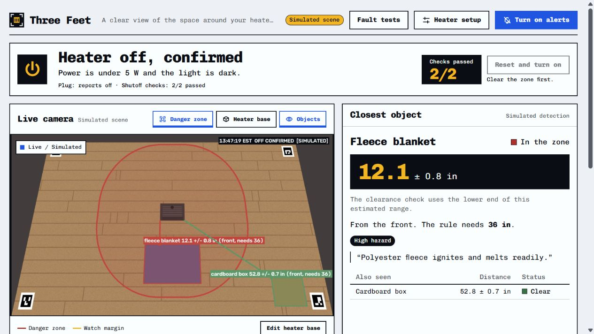

# Three Feet

AI-powered clearance monitoring for space heaters. Three Feet detects nearby objects, measures their distance, and sends a power-off request when an identified hazard remains inside the configured zone.



## Features

- **Measured clearance:** camera calibration, distances in inches, and adjustable rules for each side of the heater.
- **AI perception:** SAM 3.1 segments objects; Muse Spark identifies scene contents and assesses hazards. Local tracking follows objects between model checks.
- **Automatic power control:** configurable countdowns, plug status, command retries, and guarded manual reset. Unclassified movement waits for SAM; recognized people and worn clothing do not start object-shutoff countdowns.
- **Source-backed rules and reports:** Muse Wonder reads heater manuals for human review and summarizes incidents using the triggering object's evidence.

## Quickstart

Requires Python 3.11+, Node.js, and npm. From the repository root, in PowerShell:

```powershell
python -m venv .venv
.\.venv\Scripts\Activate.ps1
python -m pip install -e ".[dev]"
Copy-Item .env.example .env
npm --prefix web ci
npm --prefix web run build
python -m three_feet_app.app --source sim --plug dryrun
```

Open [localhost:8000](http://127.0.0.1:8000/). The simulator runs without a camera, physical plug, or API key.

On macOS/Linux, activate with `source .venv/bin/activate` and copy the settings with `cp .env.example .env`.

## Live monitoring

1. Set `MODEL_API_KEY` in `.env`, install the optional dependencies required by your plug driver, and run `python -m three_feet_app.app`.
2. Open **Camera and plug** to connect a camera and select a supported power adapter.
3. Use **Heater setup** to measure the base and review its floor-contact corners. Keep the camera fixed after calibration.
4. Review **Clearance rule**, then enable alerts and allow browser notifications. While the tab is hidden or the window minimized, you get one notification per warning, saying the heater will turn off in 10 seconds. Find or upload the heater's manual to review its required distances.

Camera inputs include USB webcams, HTTP(S) MJPEG streams, video files, and photo folders. Power control uses the [PowerSwitch interface](three_feet_app/safety/actuator.py); device support depends on the installed driver, with a simulated adapter included for testing.

| Setting | Default | Purpose |
| --- | --- | --- |
| `DEFAULT_CLEARANCE_IN` | `15` | Fallback clearance on each side |
| `WATCH_MARGIN_IN` | `2` | Amber band outside the red zone |
| `DWELL_HIGH_S` | `10` | Delay for a high-hazard object inside the zone |
| `BUDGET_USD_PER_HOUR` | `5` | Model-call budget threshold |

Only overlap with the red zone starts an object-shutoff countdown. The amber band does not expand with measurement uncertainty. After an OFF request, power is restored only through **Reset and turn on**, with fresh monitoring and a clear zone.

Use the heater manufacturer's clearance requirements. Distance estimates depend on calibration; an OFF request records a command, not proof of physical shutdown.

## Development

```powershell
python -m pytest
npm --prefix web run build
npm --prefix web run dev
```

The Vite development server proxies API, camera, and WebSocket traffic to the Python server. `npm --prefix web run build:demo` creates a static, recorded demo that cannot control hardware.

See [VALIDATION.md](VALIDATION.md) for recording physical trials and generating a results report.

## License

[MIT](LICENSE)
